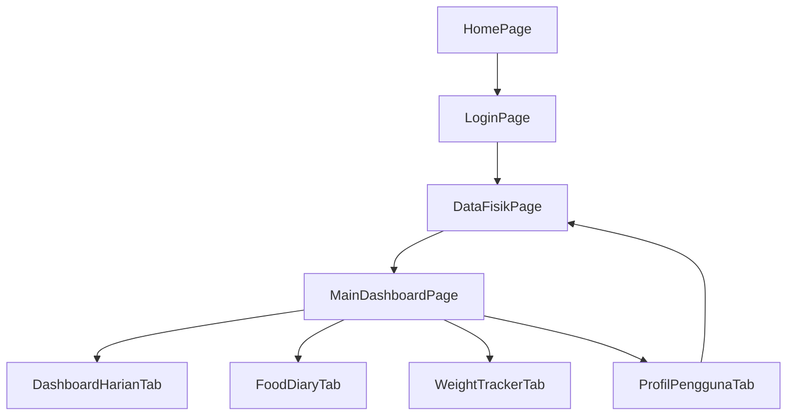

# Design Document: Dashboard Nutrisi

## Overview

Dashboard Nutrisi adalah halaman utama aplikasi Nourishia yang berfungsi sebagai pusat navigasi dan pemantauan gizi personal. Fitur ini menggantikan navigasi langsung ke `FoodDiaryPage` setelah login, dan menampilkan 4 tab utama melalui `BottomNavigationBar`:

1. **Dashboard Harian** — Ringkasan kalori & makronutrien hari ini
2. **Food Diary** — Catatan makanan persisten dengan search, add, delete, dan date picker
3. **Weight Tracker** — Halaman placeholder (coming soon)
4. **Profil Pengguna** — Tampilan data fisik, BMR, TDEE, dan tombol edit

Desain ini mengikuti pola arsitektur yang sudah ada (clean architecture sederhana: data/domain/presentation) dan menggunakan `setState` untuk state management. Database SQLite (sqflite) digunakan untuk persistensi data food diary.

## Architecture

### Layer Architecture

```
┌─────────────────────────────────────────────┐
│              Presentation Layer              │
│  ┌─────────────────────────────────────────┐│
│  │         MainDashboardPage               ││
│  │  (BottomNavigationBar + IndexedStack)   ││
│  ├─────────────────────────────────────────┤│
│  │ DashboardHarianTab │ FoodDiaryTab       ││
│  │ WeightTrackerTab   │ ProfilPenggunaTab  ││
│  └─────────────────────────────────────────┘│
├─────────────────────────────────────────────┤
│              Data Layer                      │
│  ┌───────────────────┐ ┌─────────────────┐ │
│  │  DatabaseHelper   │ │   UserModel     │ │
│  │  (Singleton)      │ │   (existing)    │ │
│  └───────────────────┘ └─────────────────┘ │
└─────────────────────────────────────────────┘
```

### Navigation Flow (Updated)



### Design Decisions

1. **IndexedStack untuk tab body**: Mempertahankan state masing-masing tab saat berpindah (memenuhi requirement 1.2 tentang mempertahankan data dan posisi scroll).
2. **Tanpa state management library**: Menggunakan `setState` sesuai pola existing. Callback function digunakan untuk komunikasi antar tab (misal: FoodDiaryTab memberitahu DashboardHarianTab ketika entri ditambahkan).
3. **DatabaseHelper singleton diperluas**: Menambahkan method baru tanpa memodifikasi struktur tabel yang sudah ada.
4. **Tanpa model baru untuk Food Diary entry**: Menggunakan `Map<String, dynamic>` sesuai pola existing di `searchFood()` dan `loginUser()`.

## Components and Interfaces

### 1. MainDashboardPage (StatefulWidget)

**File:** `lib/presentation/pages/main_dashboard_page.dart`

**Props:**
- `userId` (int) — ID user yang sedang login
- `targetTdee` (double) — Nilai TDEE hasil perhitungan Mifflin-St Jeor

**State:**
- `_currentIndex` (int) — Index tab aktif, default 0
- `_onNutritionUpdated` — Callback untuk refresh data dashboard harian

**Behavior:**
- Menampilkan `Scaffold` dengan `BottomNavigationBar` berisi 4 item
- Body menggunakan `IndexedStack` agar state tiap tab terpreservasi
- Jika tab yang sudah aktif diketuk ulang, tidak melakukan reload (requirement 1.6)

```dart
class MainDashboardPage extends StatefulWidget {
  final int userId;
  final double targetTdee;
  const MainDashboardPage({super.key, required this.userId, required this.targetTdee});
}
```

### 2. DashboardHarianTab (StatefulWidget)

**File:** `lib/presentation/pages/dashboard_harian_tab.dart`

**Props:**
- `userId` (int)
- `targetTdee` (double)

**State:**
- `_totalKalori`, `_totalKarbo`, `_totalProtein`, `_totalLemak`, `_totalSerat` (double)
- `_isLoading` (bool)

**Behavior:**
- Pada `initState`, memanggil `getDailyNutritionSummary(userId, today)` dari DatabaseHelper
- Menampilkan tanggal hari ini (format: "dd MMMM yyyy")
- Menampilkan kartu ringkasan kalori (target vs konsumsi vs sisa)
- Menampilkan 4 progress bar makronutrien dengan warna sesuai skema
- Expose method `refreshData()` yang dipanggil dari parent saat food diary berubah

**Target Distribusi Makronutrien:**
- Karbohidrat: `(TDEE × 0.55) / 4` gram
- Protein: `(TDEE × 0.15) / 4` gram
- Lemak: `(TDEE × 0.30) / 9` gram
- Serat: `30.0` gram (tetap)

### 3. FoodDiaryTab (StatefulWidget)

**File:** `lib/presentation/pages/food_diary_tab.dart`

**Props:**
- `userId` (int)
- `onEntryChanged` (VoidCallback) — Callback ke parent untuk refresh dashboard

**State:**
- `_selectedDate` (DateTime) — Tanggal yang dipilih, default DateTime.now()
- `_diaryEntries` (List<Map<String, dynamic>>) — Entri makanan pada tanggal terpilih
- `_searchResults` (List<Map<String, dynamic>>)
- `_searchController` (TextEditingController)
- `_porsiController` (TextEditingController)
- `_isLoading` (bool)

**Behavior:**
- Memuat entri dari database berdasarkan `_selectedDate`
- Search bar memanggil `DatabaseHelper.instance.searchFood(query)`
- Dialog porsi menghitung nutrisi: `(porsi / 100) × nilai_per_100g`
- Validasi porsi: > 0, <= 5000, numerik
- Insert ke database lalu refresh list dan panggil `onEntryChanged`
- Delete dengan swipe (Dismissible) + dialog konfirmasi
- Date picker menggunakan `showDatePicker()`
- Menampilkan total akumulasi nutrisi di header

### 4. WeightTrackerTab (StatelessWidget)

**File:** `lib/presentation/pages/weight_tracker_tab.dart`

**Behavior:**
- Menampilkan halaman placeholder sederhana dengan icon, teks "Segera Hadir", dan deskripsi singkat bahwa fitur ini akan tersedia di pembaruan mendatang.

### 5. ProfilPenggunaTab (StatefulWidget)

**File:** `lib/presentation/pages/profil_pengguna_tab.dart`

**Props:**
- `userId` (int)

**State:**
- `_profileData` (Map<String, dynamic>?) — Data profil dari database
- `_isLoading` (bool)
- `_errorMessage` (String?)

**Behavior:**
- Pada `initState`, memanggil `DatabaseHelper.instance.getUserProfile(userId)`
- Menampilkan: username, jenis kelamin, berat badan, tinggi badan, umur, aktivitas
- Menghitung dan menampilkan BMR (Mifflin-St Jeor) dan TDEE
- Tombol "Edit Profil" menavigasi ke `DataFisikPage`
- Setelah kembali dari `DataFisikPage`, memanggil reload data (`Navigator.push` dengan `.then()`)

### 6. DatabaseHelper (Extended)

**File:** `lib/data/datasources/database_helper.dart` (existing, ditambahi method)

**New Methods:**

```dart
/// Menyimpan entri food diary ke database
/// Returns: ID dari row yang baru diinsert
Future<int> insertFoodDiary({
  required int userId,
  required String foodName,
  required String tanggal,       // format: yyyy-MM-dd
  required double porsiGram,
  required double energiTerkonsumsi,
  required double proteinTerkonsumsi,
  required double lemakTerkonsumsi,
  required double karbohidratTerkonsumsi,
}) async { ... }

/// Mengambil semua entri food diary untuk user pada tanggal tertentu
/// Returns: List entri, diurutkan berdasarkan id DESC (terbaru di atas)
Future<List<Map<String, dynamic>>> getFoodDiariesByDate(int userId, String tanggal) async { ... }

/// Menghapus entri food diary berdasarkan ID
/// Returns: Jumlah row yang terhapus
Future<int> deleteFoodDiary(int id) async { ... }

/// Mengambil ringkasan nutrisi harian (SUM dari semua entri pada tanggal)
/// Returns: Map dengan keys: total_energi, total_protein, total_lemak, total_karbohidrat
Future<Map<String, double>> getDailyNutritionSummary(int userId, String tanggal) async { ... }
```

## Data Models

### Existing Tables (tidak diubah)

**users:**
| Column | Type | Description |
|--------|------|-------------|
| id | INTEGER PK | Auto increment |
| username | TEXT | Username login |
| password | TEXT | Password login |
| gender | TEXT | Jenis kelamin |
| weight | REAL | Berat badan (kg) |
| height | REAL | Tinggi badan (cm) |
| age | INTEGER | Umur (tahun) |
| activity_level | REAL | Faktor aktivitas (1.2-1.9) |

**foods:**
| Column | Type | Description |
|--------|------|-------------|
| id | INTEGER PK | Auto increment |
| nama | TEXT | Nama makanan |
| kategori | TEXT | Kategori makanan |
| energi | REAL | Energi per 100g (Kcal) |
| protein | REAL | Protein per 100g (g) |
| lemak | REAL | Lemak per 100g (g) |
| karbohidrat | REAL | Karbohidrat per 100g (g) |
| serat | REAL | Serat per 100g (g) |

### Existing Table (digunakan, schema tidak diubah)

**food_diaries:**
| Column | Type | Description |
|--------|------|-------------|
| id | INTEGER PK | Auto increment |
| user_id | INTEGER | FK ke users.id |
| food_name | TEXT | Nama makanan yang dicatat |
| tanggal | TEXT | Tanggal konsumsi (yyyy-MM-dd) |
| porsi_gram | REAL | Porsi dalam gram |
| energi_terkonsumsi | REAL | Energi yang dikonsumsi (Kcal) |
| protein_terkonsumsi | REAL | Protein yang dikonsumsi (g) |
| lemak_terkonsumsi | REAL | Lemak yang dikonsumsi (g) |
| karbohidrat_terkonsumsi | REAL | Karbohidrat yang dikonsumsi (g) |

**Catatan:** Tabel `food_diaries` belum memiliki kolom `serat_terkonsumsi`. Kolom ini perlu ditambahkan via migrasi database (version upgrade) agar serat juga tersimpan secara persisten. Alternatifnya, serat bisa dihitung ulang dari data foods jika food_id disimpan, namun pendekatan paling sederhana adalah menambah kolom.

### Database Migration Strategy

Karena tabel sudah dibuat di version 1, kita memiliki 2 opsi:

**Opsi yang dipilih: Tambah kolom serat via `onUpgrade`**
- Naikkan version database ke 2
- Tambahkan `serat_terkonsumsi REAL DEFAULT 0` pada `food_diaries` di `onUpgrade`
- Ini mempertahankan data existing dan backward-compatible

```dart
Future<Database> _initDB(String filePath) async {
  return await openDatabase(
    path,
    version: 2,  // naik dari 1
    onCreate: _createDB,
    onUpgrade: _upgradeDB,
  );
}

Future _upgradeDB(Database db, int oldVersion, int newVersion) async {
  if (oldVersion < 2) {
    await db.execute('ALTER TABLE food_diaries ADD COLUMN serat_terkonsumsi REAL DEFAULT 0');
  }
}
```

### UI Color Scheme (Existing, dipertahankan)

| Element | Color |
|---------|-------|
| AppBar background | `Colors.blue` |
| AppBar foreground | `Colors.white` |
| Card background | `Colors.blue.shade50` |
| Karbohidrat progress | `Colors.blue` |
| Protein progress | `Colors.redAccent` |
| Lemak progress | `Colors.orange` |
| Serat progress | `Colors.green` |
| Sisa kalori positif | `Colors.green` |
| Sisa kalori negatif | `Colors.red` |
| Button bg | `Colors.blue` |
| Button fg | `Colors.white` |
| Text accent | `Colors.blueGrey`, `Colors.grey` |


## Correctness Properties

*A property is a characteristic or behavior that should hold true across all valid executions of a system—essentially, a formal statement about what the system should do. Properties serve as the bridge between human-readable specifications and machine-verifiable correctness guarantees.*

### Property 1: Sisa Kalori Calculation

*For any* valid TDEE value (> 0) and any total consumed calories (>= 0), the remaining calories SHALL always equal TDEE minus total consumed, with the result displayed to 1 decimal place precision.

**Validates: Requirements 2.2**

### Property 2: Calorie Indicator Color Logic

*For any* pair of (totalConsumed, targetTDEE) values, the color indicator SHALL be red if totalConsumed > targetTDEE, and green if totalConsumed <= targetTDEE. There is no third state.

**Validates: Requirements 2.3, 2.4**

### Property 3: Macronutrient Target Distribution

*For any* valid TDEE value (> 0), the macronutrient targets SHALL be computed as: karbohidrat = (TDEE × 0.55) / 4, protein = (TDEE × 0.15) / 4, lemak = (TDEE × 0.30) / 9, and serat = 30.0 (constant). The sum of energy from macronutrient targets (karbo×4 + protein×4 + lemak×9) SHALL equal TDEE.

**Validates: Requirements 2.5**

### Property 4: BMR and TDEE Calculation (Mifflin-St Jeor)

*For any* valid user physical data (gender ∈ {Laki-laki, Perempuan}, weight > 0, height > 0, age > 0, activity_level ∈ {1.2, 1.375, 1.55, 1.725, 1.9}), the BMR SHALL be computed as: (10 × weight) + (6.25 × height) - (5 × age) + 5 for males, or (10 × weight) + (6.25 × height) - (5 × age) - 161 for females. TDEE SHALL equal BMR × activity_level.

**Validates: Requirements 3.2**

### Property 5: Food Diary Persistence Round-Trip

*For any* valid food diary entry (userId, foodName, tanggal, porsiGram, energi, protein, lemak, karbohidrat), inserting it via `insertFoodDiary` then querying via `getFoodDiariesByDate(userId, tanggal)` SHALL return a list containing an entry with identical field values.

**Validates: Requirements 4.1**

### Property 6: Date-Based Query Filtering

*For any* collection of food diary entries across multiple dates and a specific query date, `getFoodDiariesByDate(userId, date)` SHALL return only entries whose `tanggal` field matches the query date exactly, and SHALL NOT return entries from other dates.

**Validates: Requirements 4.2**

### Property 7: Delete Removes Entry

*For any* existing food diary entry, after calling `deleteFoodDiary(entryId)`, a subsequent call to `getFoodDiariesByDate` for the same user and date SHALL NOT contain that entry, and the total count of entries SHALL decrease by exactly 1.

**Validates: Requirements 4.4**

### Property 8: Daily Nutrition Summary is Sum of Entries

*For any* list of food diary entries on the same date for the same user, `getDailyNutritionSummary(userId, date)` SHALL return values where total_energi equals the sum of all energi_terkonsumsi, total_protein equals the sum of all protein_terkonsumsi, total_lemak equals the sum of all lemak_terkonsumsi, and total_karbohidrat equals the sum of all karbohidrat_terkonsumsi.

**Validates: Requirements 4.5**

### Property 9: Nutrient Portion Calculation

*For any* food item with known per-100g nutrient values (energi, karbohidrat, protein, lemak, serat) and any valid portion size (1–5000 grams), the computed consumed nutrients SHALL equal (porsi_gram / 100) × nutrient_per_100g for each nutrient, with the result having 1 decimal place precision.

**Validates: Requirements 5.2**

### Property 10: Portion Input Validation

*For any* input string that is either non-numeric (cannot be parsed as a double), or represents a numeric value ≤ 0 or > 5000, the validation SHALL reject the input and prevent food diary entry creation. Conversely, for any input string that parses to a number in the range (0, 5000], validation SHALL accept the input.

**Validates: Requirements 5.4, 5.5**

## Error Handling

### Database Errors

| Scenario | Handling | UI Feedback |
|----------|----------|-------------|
| `insertFoodDiary` fails | Catch exception, do not update UI state | SnackBar: "Gagal menyimpan catatan makanan" |
| `getFoodDiariesByDate` fails | Catch exception, set empty list | Tampilkan pesan error di area list |
| `deleteFoodDiary` fails | Catch exception, do not remove from UI | SnackBar: "Gagal menghapus catatan makanan" |
| `getDailyNutritionSummary` fails | Catch exception, show zeros | Tampilkan pesan error singkat |
| `getUserProfile` fails | Catch exception, set `_errorMessage` | Tampilkan pesan: "Data profil tidak dapat dimuat" |

### Input Validation Errors

| Scenario | Handling | UI Feedback |
|----------|----------|-------------|
| Porsi gram ≤ 0 atau > 5000 | Reject, stay in dialog | Teks error: "Porsi harus antara 1-5000 gram" |
| Porsi non-numerik | Reject, stay in dialog | Teks error: "Masukkan angka yang valid" |
| Search kosong | Clear results, no query | Tidak menampilkan error |

### State Recovery

- Jika data gagal dimuat saat tab dibuka, user bisa pull-to-refresh atau berpindah tab lalu kembali
- Database helper menggunakan try-catch pada semua operasi async
- setState hanya dipanggil setelah operasi berhasil (optimistic UI tidak digunakan)

## Testing Strategy

### Unit Tests (Example-Based)

Unit tests fokus pada skenario spesifik dan edge cases:

1. **Widget Tests:**
   - MainDashboardPage renders 4 tabs with correct labels
   - Default tab is Dashboard Harian (index 0)
   - WeightTrackerTab shows "Segera Hadir" placeholder
   - ProfilPenggunaTab displays all user fields
   - FoodDiaryTab shows empty state message when no entries
   - Dialog porsi shows default 100g and nutrient info
   - Confirmation dialog appears on delete

2. **Database Integration Tests:**
   - insertFoodDiary returns valid ID
   - searchFood with >20 matches returns max 20
   - getFoodDiariesByDate with no entries returns empty list
   - Database migration adds serat_terkonsumsi column

### Property-Based Tests

Property-based tests memvalidasi universal properties menggunakan library `dart_quickcheck` atau `glados` (Dart PBT library).

**Configuration:** Minimum 100 iterations per property test.

**Tag format:** `Feature: dashboard-nutrisi, Property {number}: {property_text}`

Properties to implement:
1. Sisa kalori calculation
2. Calorie indicator color logic
3. Macronutrient target distribution formula
4. BMR/TDEE Mifflin-St Jeor calculation
5. Food diary persistence round-trip (with in-memory SQLite)
6. Date-based query filtering
7. Delete removes entry
8. Daily nutrition summary = sum of entries
9. Nutrient portion calculation
10. Portion input validation (reject invalid, accept valid)

### Test Library Choice

**Recommended: `glados` package** — A property-based testing library for Dart that integrates with `package:test`. It supports automatic shrinking and custom generators.

```yaml
dev_dependencies:
  glados: ^1.1.1
  flutter_test:
    sdk: flutter
  sqflite_common_ffi: ^2.3.3  # already present, for in-memory DB testing
```

### Test Structure

```
test/
├── unit/
│   ├── nutrition_calculation_test.dart    # Properties 1, 2, 3, 9
│   ├── bmr_tdee_calculation_test.dart     # Property 4
│   ├── portion_validation_test.dart       # Property 10
│   └── database_helper_test.dart          # Properties 5, 6, 7, 8
└── widget/
    ├── main_dashboard_page_test.dart
    ├── dashboard_harian_tab_test.dart
    ├── food_diary_tab_test.dart
    ├── weight_tracker_tab_test.dart
    └── profil_pengguna_tab_test.dart
```
